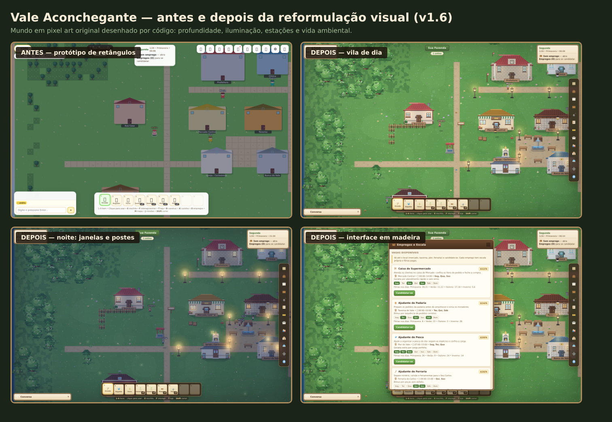
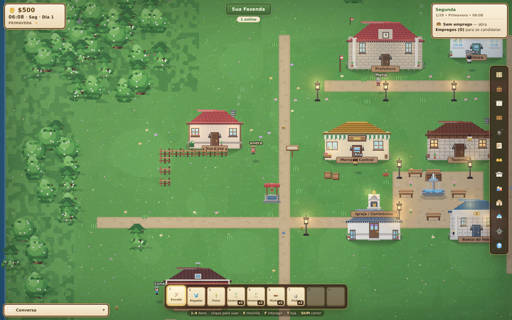
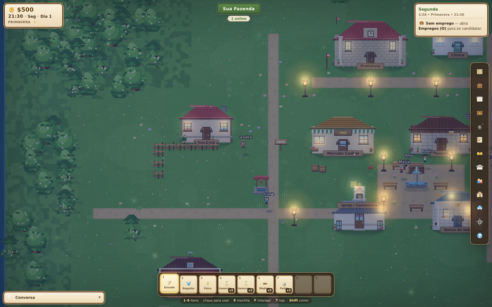
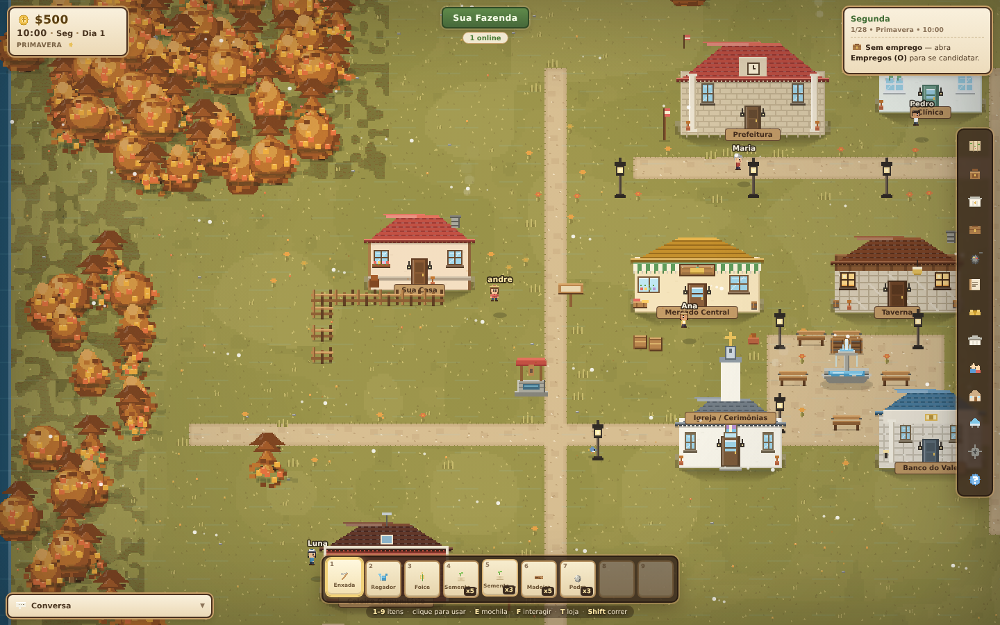
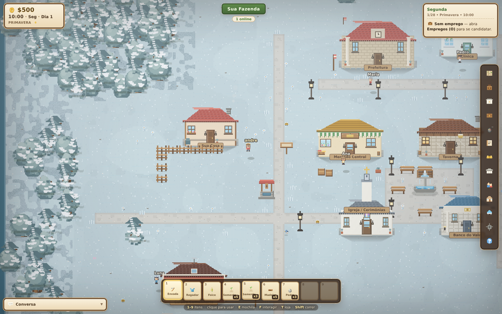
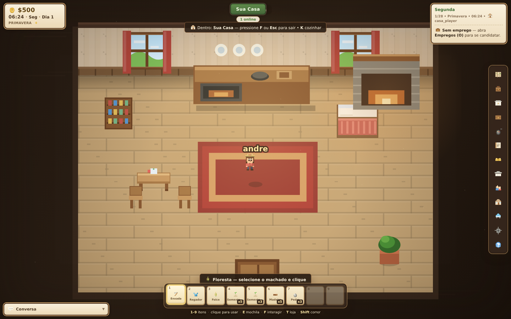

# Vale Aconchegante

Jogo 2D de **simulação de vida, fazenda e RPG multiplayer**, feito do zero, com código original e arquitetura modular pensada para crescer por fases.

> Inspirado na atmosfera acolhedora de jogos de fazenda como Stardew Valley, mas com **identidade própria**: nenhum asset, música, personagem ou texto foi copiado. Todo o conteúdo é original ou gerado proceduralmente pelo próprio jogo.



| Vila de dia | Noite com janelas acesas |
|---|---|
|  |  |

| Outono | Inverno |
|---|---|
|  |  |



---

## ✅ O que já está jogável (v1.6)

| Sistema | Status | Detalhes |
|---|---|---|
| Tela inicial + contas | ✅ | Login/cadastro gratuito, visitante, sessão com token assinado (HMAC), senha com scrypt |
| Criação de personagem | ✅ | 6 aparências + nome, salvos no navegador |
| Mundo 2D top-down | ✅ | Mapa 70×50 tiles: fazenda, cidade, prefeitura, mercado, carpintaria, ferraria, clínica, taverna, celeiro, lago, rio, praia, floresta, mina |
| Movimento e colisão | ✅ | WASD/setas, Shift para correr, colisão com água e construções, câmera suave |
| Agricultura | ✅ | Arar → plantar → regar → colher, 8 culturas, estações, estufa, fertilidade (regra de rega diária) |
| Animais | ✅ | Galinha, vaca, ovelha — precisam de celeiro e produzem ovo/leite/lã no avanço do dia |
| Economia | ✅ | Compra/venda, 6 ferramentas, materiais, animais; nada de dinheiro real |
| Multiplayer real | ✅ | Salas por código, sincronização em tempo real, chat, votação para dormir, host migra se sair |
| Salvamento | ✅ | Mundo persistido em disco com escrita atômica + autosave + reconexão |
| NPCs | ✅ | 6 moradores com rotina por horário, personalidade, gostos, história e diálogos variados |
| Amizade | ✅ | Conversar e presentear, barra de amizade, gostos/desgostos afetam o ganho |
| Missões | ✅ | 7 missões com progresso por estatísticas e resgate de recompensa |
| Comunidade | ✅ | 4 projetos (praça, biblioteca, ponte, estradas) com progresso compartilhado e mudança visual — a ponte abre passagem no rio |
| Construção | ✅ | 6 tipos de construção posicionáveis, custo em materiais + ouro, prévia verde/vermelha, validação de sobreposição |
| Habilidades | ✅ | 6 skills com XP e nível (agricultura, pesca, mineração, construção, culinária, comércio) |
| Dia/noite + clima | ✅ | Relógio sincronizado, ciclo visual, 5 climas, estações com paleta própria e festival no dia 28 |
| Interface | ✅ | HUD, hotbar 1–9, mochila, loja com abas, missões, comunidade, mapa, social, configurações |
| Áudio original | ✅ | Trilha e efeitos gerados proceduralmente com Web Audio API (nada protegido, nada baixado) |
| Testes | ✅ | 44 testes de multiplayer real com 2 clientes + 47 testes de interface em jsdom |

### O que entrou na v1.6 — reformulação visual completa

Toda a arte do jogo foi refeita do zero, em **pixel art original desenhada por código** (nenhum asset de terceiros):

- **Personagens**: sprites 16×24 com 4 direções, ciclo de caminhada de 4 quadros, pose de ação com ferramenta na mão, respiração parada, 6 visuais de jogador e 10 moradores com identidade própria (cabelo, chapéu, avental, barba).
- **Construções**: prefeitura, clínica, carpintaria, mercado, taverna, ferraria, banco, igreja, celeiro, mina, píer e aeródromo redesenhados com telhado em duas águas, beiral, chaminé, vitrine, toldo listrado, janelas iluminadas e placa de madeira.
- **Cenário**: grama com manchas orgânicas, floresta densa com transição irregular, 3 silhuetas de árvore (redonda, alta e pinheiro) que balançam com o vento, arbustos, pedras, flores, tufos, poço, fonte, estátua, bancos, postes, cercas, barris, caixotes, placas e espantalho.
- **Ciclo de dia e noite**: amanhecer, meio-dia, pôr do sol e noite com luz quente direcional, raios de sol, luar azulado, janelas acesas, postes com halo e vinheta suave.
- **Estações**: primavera com flores, verão vibrante, outono com folhas alaranjadas caindo e inverno com neve acumulada nas árvores e flocos no ar.
- **Vida ambiental**: pássaros que ciscam e voam quando você chega, borboletas, abelhas, gatos que dormem e passeiam, vaga-lumes à noite, fumaça nas chaminés e pétalas ao vento.
- **Interiores**: casa, taverna, mercado, banco, igreja, ferraria, clínica, prefeitura e carpintaria com piso de tábua, papel de parede, janelas com cortina, lareira acesa, móveis e iluminação quente.
- **Interface**: HUD em madeira e pergaminho, moeda e ícones em pixel art (sem emojis), barra lateral de menu com tooltips, chat retrátil, agenda de turno, painéis com moldura, inventário com sprites reais e retratos de NPC desenhados.
- **Efeitos**: poeira ao caminhar, partículas de coleta, lascas ao cortar, brilho ao minerar, ondas na água, respingos de chuva e neve.
- **Desempenho**: chão pré-renderizado em cache, sprites cacheados, luzes com gradiente em cache, qualidade adaptativa automática e limite de partículas.

### O que entrou na v1.5 — expansões 2026

- **Culinária completa**: 10 receitas (queijo, pão, salada, sopa, omelete, peixe grelhado, torta, doce de mel, pizza, banquete), fogão/forno/panela, XP de culinária e consumo de refeições.
- **Interiores**: entre em casa, taverna, mercado, banco, igreja — vista interna com fogão jogável e móveis.
- **Empregos com escala real**: 4 carreiras (Caixa, Padeiro, Pescador, Ferreiro) com salário em **dólares** ($10–$16/h), turnos com horário, dias de trabalho (Seg–Dom), **férias remuneradas** (50% do turno), reputação e agenda no canto direito.
- **Transportes**: barco (Vila + Ilha) e avião (Cidade Grande) — desbloqueados por projetos “Porto” ($1200) e “Estação” ($1800).
- **3 novas regiões**: Vila Costeira, Ilha Tropical e Cidade Grande, com 4 novos NPCs (Bia, Tai, Rita, Duda).
- **Missões em cadeia**: 4 jornadas em 4 etapas com recompensas grandes.
- **Missões cooperativas semanais**: 4 metas de sala que pagam todos; reset toda segunda.
- **Banco do Vale**: depósito, saque, transferência, empréstimo até $2000 com juros.
- **Casas & família**: compra de 3 casas, 7 móveis, relacionamento casável, namoro → noivado → casamento na Igreja e filho.

### Ainda planejado (próximas fases, arquitetura já preparada)

- Negócios 100% geridos com contratação real.
- Cadeia logística entre jogadores (restaurante ↔ agricultor).
- Cavernas em níveis com puzzles e minérios raros.
- Festivais plenamente jogáveis com minigames.
- Permissões de terreno e visitas a casas de amigos.

---

## 🚀 Como rodar (2 minutos)

Pré-requisito: **Node.js 18+** (recomendado 20 ou 22).

```bash
npm install
npm start
```

Abra **http://localhost:3000**, escolha *Visitante* (para testar) ou crie uma conta gratuita.

Para jogar com alguém na mesma rede, use o IP da sua máquina: `http://SEU_IP:3000`.
Para jogar com amigos pela internet, veja as opções gratuitas em [`docs/COMO_GERAR_EXE.md`](docs/COMO_GERAR_EXE.md#jogar-online-com-amigos).

### Testes automatizados

```bash
npm run test:client   # interface em jsdom (47 verificações)
npm start             # em outro terminal
npm test              # multiplayer real com 2 clientes Socket.IO (44 verificações)
```

O teste de multiplayer cria uma conta, uma sala, dois jogadores reais, planta, rega, dorme 3 noites, colhe, vende, constrói, doa para a comunidade, resgata missão, testa persistência de conta, personificação, desconexão e reconexão.

---

## 🖥️ Gerar o `.exe` (Windows)

```bash
npm install
npm run build:exe            # instalador NSIS + portátil
# ou
npm run build:exe:portable   # só o executável portátil (mais rápido)
```

O resultado sai em **`dist/`**. O Electron embute o servidor Node dentro do app e escolhe uma porta livre — o jogo abre como um programa normal, sem terminal.

> Para testar a versão desktop sem gerar instalador: `npm run electron`.
> Detalhes, solução de problemas e build em Linux/macOS: [`docs/COMO_GERAR_EXE.md`](docs/COMO_GERAR_EXE.md).

---

## 🎮 Controles

| Ação | Tecla |
|---|---|
| Mover | `W A S D` ou setas |
| Correr | `Shift` |
| Usar item selecionado | Clique no mapa |
| Selecionar item | `1`–`9` ou roda do mouse |
| Interagir / pescar | `F` ou `Espaço` |
| Mochila | `E` |
| Mercado | `T` |
| Construir | `B` |
| Mapa | `M` |
| Missões | `J` |
| Comunidade | `C` |
| Social | `P` |
| Configurações / fechar painel | `Esc` |
| Chat | `Enter` |

No celular: D-pad e botão de ação aparecem automaticamente.

### Primeiros passos
1. Selecione a **enxada** (1) e clique na grama da fazenda.
2. Selecione uma **semente** e clique na terra arada.
3. Selecione o **regador** (2) e regue. Só cresce se estiver regada no fim do dia.
4. Quando a planta brilhar, clique nela ou use a **foice** para colher.
5. Venda no **Mercado** (T), compre ferramentas e contribua com a **praça** (C).

---

## 🧩 Arquitetura

```
Jogo/
├── client/                  # Front-end (canvas + UI), sem build step
│   ├── index.html
│   ├── css/style.css
│   ├── js/
│   │   ├── main.js          # bootstrap, input, loop, regras de clique
│   │   ├── state.js         # estado do jogo, colisão, helpers de item
│   │   ├── network.js       # Socket.IO: eventos e comandos
│   │   ├── renderer.js      # desenho do mundo, jogadores, NPCs, clima
│   │   ├── ui.js            # HUD, painéis, lojas, missões, configurações
│   │   └── audio.js         # música e SFX procedurais
│   ├── vendor/              # socket.io client local (funciona offline)
│   └── assets/              # ícone do jogo/executável
├── server/
│   ├── server.js            # HTTP + Socket.IO + APIs + tick do mundo
│   ├── gameActions.js       # TODAS as regras de gameplay (fonte da verdade)
│   ├── worldState.js        # mapa determinístico, dia/noite, crescimento, save atômico
│   ├── rooms.js             # salas, entrada/saída, host, persistência por conta
│   └── accounts.js          # cadastro/login, scrypt, token HMAC
├── shared/
│   └── constants.js         # dados de culturas, NPCs, construções, missões (cliente+servidor)
├── test/                    # testes de multiplayer e de interface
├── electron.cjs             # servidor embutido + janela do jogo
└── docs/                    # arquitetura, roadmap e guia do .exe
```

**Regra de ouro:** o cliente nunca decide nada importante. Ele envia intenções (`till`, `plant`, `buy`…) e o servidor valida custo, distância, cooldown e estado. Assim o multiplayer não dessincroniza e não dá para trapacear ouro ou item pelo console.

- Detalhes de estado compartilhado × individual, netcode, segurança e limitações: [`docs/ARQUITETURA.md`](docs/ARQUITETURA.md)
- Fases planejadas: [`docs/ROADMAP.md`](docs/ROADMAP.md)

---

## 💚 Princípios do projeto

- **Grátis para sempre**: sem assinatura, sem microtransação, sem moeda premium, sem loja real.
- **Multiplayer desde o início**: arquitetura de servidor autoritativo, não um "modo" acoplado depois.
- **Conteúdo original**: nenhum arquivo de áudio, sprite ou texto de terceiros.
- **Modular**: cada sistema em seu módulo, para crescer sem reescrever.
- **Honestidade técnica**: se algo é limitação, está documentado — nada de fingir que existe.

---

## 📄 Licença

MIT — use, estude, modifique e publique sua versão, mantendo os créditos.
